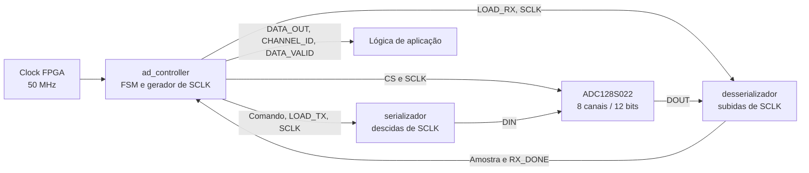

# Controlador SPI para o ADC128S022 — DE0-Nano

Implementação em **VHDL** de um controlador para leitura sequencial dos canais do conversor **ADC128S022**, utilizado na placa **Terasic DE0-Nano**. O projeto inclui os blocos de transmissão e recepção SPI, a máquina de estados do controlador, um modelo comportamental do ADC e um *testbench* integrado para o **ModelSim 10.5b**.

> **Estado do projeto:** simulação funcional integrada aprovada em 10 frames no teste apresentado; síntese, análise de temporização e validação na placa física **ainda não documentadas como concluídas**.

## Visão geral



A interface recebe uma palavra serial de 16 bits por transação: **quatro zeros seguidos dos 12 bits da conversão**. O canal solicitado em `DIN` passa a ser convertido no **frame seguinte**; por isso, o controlador mantém separados o canal recebido e o próximo canal solicitado.

### Características desta implementação

| Parâmetro | Valor / comportamento |
|---|---|
| Clock principal | 50 MHz (`CLK`) |
| Clock SPI padrão | 1,5625 MHz (`MT_ADC = 16`) |
| Bits por frame | 16 |
| Resolução útil | 12 bits |
| Número de canais | 1 a 8 (`NUM_CANAIS`; exemplo de simulação: 8) |
| Ordem dos bits | MSB primeiro |
| `ADC_CS` | Ativo em nível baixo |
| SCLK em repouso | Nível alto |
| Serializador | Usa as **descidas** de SCLK |
| Desserializador | Usa as **subidas** de SCLK |
| Resultado válido | `DATA_VALID` por 1 ciclo do clock de 50 MHz |

## Por onde começar? Entenda os arquivos primeiro

Se você está conhecendo VHDL ou abrindo este projeto pela primeira vez, comece pelo **[guia de arquivos e terminologias](docs/guia-arquivos.md)**. Ele explica, com exemplos, **para que serve cada arquivo**, **como os módulos se conectam** e como o testbench verifica uma conversão.

> **`tb` é a abreviação de _testbench_.** O arquivo `sim/tb_adc128s022_integrado.vhd` **testa** o controlador; ele não é o ADC nem faz parte do circuito sintetizado. O arquivo `sim/adc128s022_model.vhd` é o **ADC simulado** que o testbench utiliza. Já os três arquivos `rtl/*.vhd` descrevem a lógica projetada para a FPGA.

| Comece por | Entenda o quê? |
|---|---|
| [`rtl/adc_controller_sclk.vhd`](rtl/adc_controller_sclk.vhd) | Controlador principal: FSM, SCLK, CS e canais |
| [`rtl/serializador_sclk.vhd`](rtl/serializador_sclk.vhd) | Comando de 16 bits transmitido ao ADC |
| [`rtl/desserializador_sclk.vhd`](rtl/desserializador_sclk.vhd) | Amostra serial recebida do ADC |
| [`sim/adc128s022_model.vhd`](sim/adc128s022_model.vhd) | ADC virtual que responde ao controlador |
| [`sim/tb_adc128s022_integrado.vhd`](sim/tb_adc128s022_integrado.vhd) | Testbench: aplica estímulos e confere respostas |
| [`sim/simular_modelsim.do`](sim/simular_modelsim.do) | Script para compilar e executar o teste |

## Comece pela simulação

1. Instale/abra o **ModelSim 10.5b** e defina como diretório de trabalho a **raiz deste repositório**.
2. Execute no console (*Transcript*):

   ```tcl
   do sim/simular_modelsim.do
   ```

3. Observe `ADC_CS`, `ADC_SCLK`, `ADC_DIN`, `ADC_DOUT`, `CHANNEL_ID`, `DATA_OUT` e `DATA_VALID`.
4. No console, cada verificação bem-sucedida deve mostrar `Frame N OK` e nenhum `** Error:`. O script compila com `vcom -2008` e executa `140 us`.

> A simulação usa entradas `REAL` e atrasos temporais no modelo do ADC: **`sim/adc128s022_model.vhd` não deve ser sintetizado na FPGA**.


*Captura de uma execução do projeto: varredura dos canais e palavras recebidas (exemplo visual; amplie a figura para os detalhes).*

## Estrutura do repositório

```text
.
├── README.md
├── rtl/
│   ├── adc_controller_sclk.vhd          # Entidade: ad_controller
│   ├── serializador_sclk.vhd            # Entidade: serializador
│   └── desserializador_sclk.vhd         # Entidade: desserializador
├── sim/
│   ├── adc128s022_model.vhd             # ADC comportamental; não sintetizável
│   ├── tb_adc128s022_integrado.vhd      # Testbench completo
│   └── simular_modelsim.do              # Compilação e simulação
└── docs/
    ├── guia-arquivos.md                 # Tutorial: arquivos, conexões e termos
    ├── arquitetura.md                   # Blocos, sinais e FSM
    ├── protocolo-spi.md                 # Bits, bordas e pipeline de canais
    ├── validacao.md                     # Testes, resultados e limitações
    ├── implementacao-fisica.md          # Checklist Quartus / DE0-Nano
    └── images/
        └── ondas_modelsim.png
```

## Documentação técnica

Para entender o funcionamento em ordem recomendada:

1. [Guia para iniciantes: arquivos, conexões e terminologias](docs/guia-arquivos.md)
2. [Arquitetura e máquina de estados](docs/arquitetura.md)
3. [Protocolo SPI e temporização](docs/protocolo-spi.md)
4. [Testbench e resultados da simulação](docs/validacao.md)
5. [Pendências para a implementação física](docs/implementacao-fisica.md)

## Interface do módulo principal

O módulo superior tem o nome de **entidade `ad_controller`** (apesar de o arquivo se chamar `adc_controller_sclk.vhd`). Seus genéricos são `NUM_CANAIS` (1 a 8; padrão 3) e `MT_ADC` (ciclos de 50 MHz por **meio período** de SCLK; padrão 16).

| Porta | Direção | Finalidade |
|---|---|---|
| `CLK` | Entrada | Clock da FPGA (50 MHz) |
| `RST` | Entrada | Reset ativo alto |
| `ENABLE` | Entrada | Habilitação da varredura; ver [FSM](docs/arquitetura.md) |
| `ADC_CS` | Saída | Seleção do ADC, ativa em zero |
| `ADC_SCLK` | Saída | Clock SPI gerado |
| `ADC_DIN` | Saída | Comando serial para ADC |
| `ADC_DOUT` | Entrada | Dados seriais do ADC |
| `DATA_OUT[15:0]` | Saída | `0000` + código digital de 12 bits |
| `CHANNEL_ID` | Saída | Canal ao qual `DATA_OUT` corresponde |
| `DATA_VALID` | Saída | Pulso que indica nova amostra completa |

## Escopo e referências

Este repositório documenta uma **implementação específica** para fins de desenvolvimento e simulação. O modelo comportamental não substitui medições reais, validação de *timing* ou testes na placa.

- [Texas Instruments — ADC128S022 (produto e datasheet)](https://www.ti.com/product/ADC128S022)
- [GitHub — README e arquivos Markdown](https://docs.github.com/en/repositories/managing-your-repositorys-settings-and-features/customizing-your-repository/about-readmes)

**Licença:** ainda não definida. Antes de aceitar contribuições/reutilização pública, adicionar um `LICENSE` compatível com a titularidade do código.
