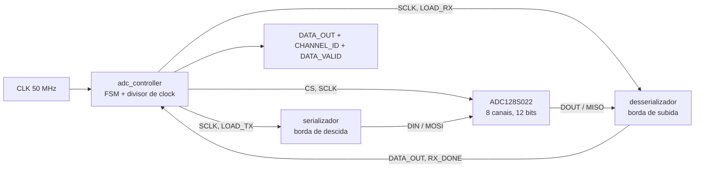

# SPI Controller for ADC128S022 | DE0-Nano

Controlador **SPI em VHDL** para aquisição sequencial de até **oito canais** do conversor **ADC128S022**, presente na placa **Terasic DE0-Nano**. O projeto contém a lógica digital destinada à FPGA, um **modelo comportamental do ADC** e um **testbench integrado** executado no **ModelSim 10.5b**.

> **Status:** validação funcional realizada anteriormente com 10 frames e oito canais, incluindo mudança de entrada analógica simulada. A versão reorganizada nesta pasta troca **apenas nomes de entidade e forma de instanciação**; sua simulação deve ser executada novamente após a atualização. **Síntese, timing no TimeQuest e teste no hardware ainda estão pendentes.**

## Visão geral



A FPGA gera o clock SPI (`ADC_SCLK`) a partir do clock principal de 50 MHz. O ADC recebe um comando de seleção de canal em `DIN`, devolvendo em `DOUT` uma palavra de **16 bits**: quatro zeros iniciais e os **12 bits válidos**. O endereço transmitido em um frame define o canal convertido **no frame seguinte**.

## Nomes dos arquivos

Os módulos usam os nomes originais **sem o sufixo `_sclk`**:
`adc_controller.vhd`, `serializador.vhd` e `desserializador.vhd`.
O sufixo foi utilizado indevidamente em uma versão anterior do pacote.
O script `simular_modelsim.do` procura esses nomes em `rtl/`, `sim/` e na **raiz** do repositório.

## Organização do repositório

```text
.
├── README.md
├── rtl/
│   ├── adc_controller.vhd
│   ├── serializador.vhd
│   └── desserializador.vhd
├── sim/
│   ├── adc128s022_model.vhd
│   ├── tb_adc128s022_integrado.vhd
│   └── simular_modelsim.do
└── docs/
    ├── guia-arquivos.md
    ├── arquitetura.md
    ├── protocolo-spi.md
    ├── validacao.md
    └── implementacao-fisica.md
```

### O que faz cada arquivo?

| Arquivo | Papel | Sintetizável? |
|---|---|---|
| [`rtl/adc_controller.vhd`](rtl/adc_controller.vhd) | Entidade `adc_controller`: FSM, comando de canais, `CS`, `SCLK` e sincronização de `RX_DONE` | Sim, sujeito à validação de timing |
| [`rtl/serializador.vhd`](rtl/serializador.vhd) | Entidade `serializador`: apresenta os 16 bits do comando em `DIN`, nas descidas de SCLK | Sim |
| [`rtl/desserializador.vhd`](rtl/desserializador.vhd) | Entidade `desserializador`: captura `DOUT` nas subidas de SCLK e gera `RX_DONE` | Sim |
| [`sim/adc128s022_model.vhd`](sim/adc128s022_model.vhd) | **Modelo do ADC**: emula os oito canais e os tempos digitais da interface; recebe tensões do tipo `REAL` | **Não** |
| [`sim/tb_adc128s022_integrado.vhd`](sim/tb_adc128s022_integrado.vhd) | **Testbench (`tb`)**: conecta controlador e ADC simulado, aplica tensões e confere as respostas por `ASSERT` | **Não** |
| [`sim/simular_modelsim.do`](sim/simular_modelsim.do) | **Script ModelSim**: compila, inicia a simulação e adiciona sinais à janela Wave | Não se aplica |

**Terminologia:** `tb` significa *testbench*, `DUT` significa *Device Under Test* (o controlador sob teste) e `U_ADC` é a instância do ADC virtual. O **modelo do ADC não é o testbench**: ele é um componente de simulação usado *pelo* testbench.

## Como executar no ModelSim 10.5b

Na pasta raiz do repositório, abra o ModelSim e execute na janela **Transcript**:

```tcl
do sim/simular_modelsim.do
```

O script usa `vcom -2008` para compilar, nesta ordem:

1. Serializador e desserializador (`rtl/`).
2. Controlador principal (`rtl/`).
3. Modelo comportamental do ADC (`sim/`).
4. Testbench integrado (`sim/`).

Depois carrega o testbench, apresenta as principais ondas e executa **140 µs**. A biblioteca é criada em `modelsim_work/` **dentro do projeto** para evitar a utilização de uma biblioteca `work` antiga ou mapeada para o diretório do Intel FPGA. **Não envie `modelsim_work/` ao GitHub**: é um produto da compilação.

O comando do script `vsim work.tb_adc128s022_integrado` usa `work` **apenas para indicar a biblioteca da simulação**. No VHDL, as instâncias foram escritas por `COMPONENT` e `PORT MAP`, sem `ENTITY work...`.

### O que observar

Os sinais principais são `ADC_CS`, `ADC_SCLK`, `ADC_DIN`, `ADC_DOUT`, `DATA_OUT`, `CHANNEL_ID` e `DATA_VALID`. Para cada transação:

- `CS` fica baixo durante **16 ciclos** de SCLK.
- O serializador opera nas **descidas**; o desserializador captura nas **subidas**.
- `DATA_VALID` sinaliza que `DATA_OUT` e `CHANNEL_ID` correspondem à amostra concluída.
- `RX_DONE` é sincronizado para o clock de 50 MHz, evitando encerrar prematuramente o frame seguinte.

No teste integrado, a sequência esperada é:

| Frame | Canal | Código decimal | Hexadecimal |
|---|---:|---:|---|
| 1 | 0 | 291 | `0123` |
| 2 | 1 | 1110 | `0456` |
| 3 | 2 | 1929 | `0789` |
| 4 | 3 | 2748 | `0ABC` |
| 5 | 4 | 3567 | `0DEF` |
| 6 | 5 | 4095 | `0FFF` |
| 7 | 6 | 1 | `0001` |
| 8 | 7 | 2080 | `0820` |
| 9 | 0 | 801 | `0321` (IN0 atualizado) |
| 10 | 1 | 1110 | `0456` |

Esse é o **resultado de referência do teste anterior**, não uma afirmação de que o pacote reorganizado já foi executado no ModelSim.

## Interface do controlador

| Porta/genérico | Função |
|---|---|
| `CLK` | Clock principal da FPGA, 50 MHz |
| `RST` | Reset ativo alto |
| `ENABLE` | Habilita a varredura contínua |
| `ADC_CS` | Seleção do conversor, ativa em zero |
| `ADC_SCLK` | Clock SPI (repouso em nível alto) |
| `ADC_DIN` | Comando enviado ao ADC |
| `ADC_DOUT` | Resposta serial recebida do ADC |
| `DATA_OUT[15:0]` | Quatro zeros e código de 12 bits |
| `CHANNEL_ID` | Identificação do canal da amostra atual |
| `DATA_VALID` | Pulso de validação da amostra |
| `NUM_CANAIS` | Genérico: 1–8 canais (no testbench, 8) |
| `MT_ADC` | Genérico: quantidade de ciclos do CLK por **meio período** de SCLK (16 por padrão) |

Com `CLK = 50 MHz` e `MT_ADC = 16`, a frequência nominal é **1,5625 MHz**, e um frame de 16 ciclos dura **10,24 µs**, sem contar o intervalo entre transações.

## Instanciação por componentes: qual a diferença?

O controlador declara `COMPONENT serializador` e `COMPONENT desserializador`, conectando-os com `PORT MAP`. O testbench declara `COMPONENT adc_controller` e `COMPONENT adc128s022_model`.

Isso **não altera o circuito** em relação à instanciação direta `ENTITY work...`, desde que nomes e interfaces estejam consistentes e todas as entidades/arquiteturas estejam compiladas. O nome padronizado neste repositório é **`adc_controller`**, inclusive na declaração `ENTITY adc_controller IS`, evitando o desencontro anterior entre `ad_controller` e `adc_controller`.

## Documentação e limitações

- [Guia dos arquivos e termos](docs/guia-arquivos.md)
- [Arquitetura e FSM](docs/arquitetura.md)
- [Protocolo SPI](docs/protocolo-spi.md)
- [Testes e critérios de validação](docs/validacao.md)
- [Validação física pendente](docs/implementacao-fisica.md)

A implementação usa **SCLK como clock dos registradores** e contém uma travessia de domínio de clock (`RX_DONE` de SCLK para 50 MHz). É indispensável conferir restrições, rotas de clock e *setup/hold* no Quartus/TimeQuest antes de declarar o hardware validado.

**Referência principal:** [Texas Instruments — ADC128S022](https://www.ti.com/product/ADC128S022).
