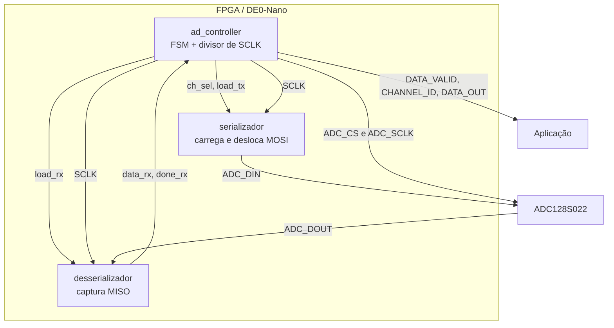
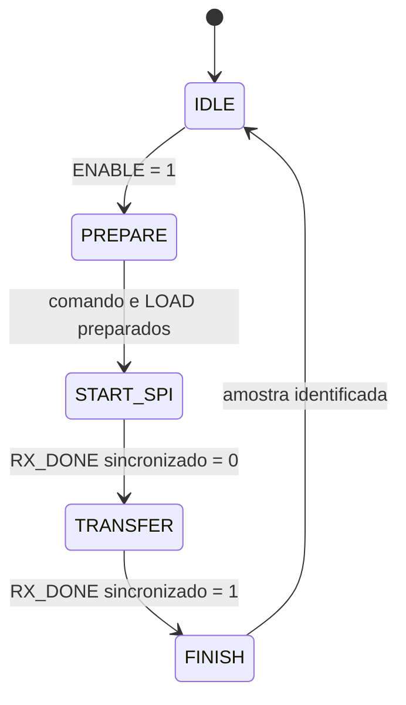

# Arquitetura do controlador

[← README](../README.md) · [Guia de arquivos](guia-arquivos.md) · [Protocolo SPI →](protocolo-spi.md)

## Objetivo

Coordenar a comunicação SPI com o ADC128S022 para ler sequencialmente de `NUM_CANAIS` canais, identificando a origem de cada amostra. O código é dividido em um controlador e dois registradores seriais.

## Blocos

### `rtl/adc_controller_sclk.vhd` — entidade `ad_controller`

- Utiliza `rising_edge(CLK)` de 50 MHz.
- `MT_ADC` é o divisor de **meio período**: `f_SCLK = 50 MHz / (2 × MT_ADC)`. Para `MT_ADC = 16`, obtém-se **1,5625 MHz** (640 ns por ciclo completo).
- Gera `ADC_CS`, `ADC_SCLK` e a palavra de comando `ch_sel`.
- Seleciona o próximo canal e registra `CHANNEL_ID` da amostra anterior.
- Recebe `RX_DONE` do domínio SCLK, passando por `rx_done_meta` e `rx_done_sync` (dois registradores de sincronização).
- Publica `DATA_VALID` como pulso de **um período de 50 MHz** (~20 ns).

### `rtl/serializador_sclk.vhd` — entidade `serializador`

- `CLK` local é o **SCLK gerado**, e não 50 MHz.
- Recebe `LOAD=1` na **primeira descida** de SCLK, carregando os 16 bits.
- Nas **15 descidas seguintes**, desloca D14 até D0 para `MOSI`.
- `SHIFT_EN` é uma **habilitação de nível** ativa durante `CS=0`; não é pulso por bit nessa arquitetura.
- `TX_DONE` indica que o último bit **foi apresentado**, mas não garante sua captura pelo ADC.

### `rtl/desserializador_sclk.vhd` — entidade `desserializador`

- `CLK` local é o **SCLK gerado**.
- Em cada **subida** de SCLK, captura um bit de `ADC_DOUT`, totalizando 16 bits.
- `LOAD` limpa contador e sinal de término **mesmo com SCLK parado**, para permitir um novo frame.
- `DATA_OUT` só muda quando a 16ª captura é concluída.
- `RX_DONE` **permanece em 1** até o próximo `LOAD` (não é um pulso de 20 ns).

## Máquina de estados

| Estado | Responsabilidade |
|---|---|
| `IDLE` | Mantém CS alto, desabilita SCLK e espera `ENABLE` |
| `PREPARE` | Calcula `ch_prox`, compõe `ch_sel`, ativa `load_tx`/`load_rx` |
| `START_SPI` | Aguarda a limpeza sincronizada do `RX_DONE` anterior e inicia CS/SCLK |
| `TRANSFER` | Executa o frame; desativa `LOAD` após a primeira descida; aguarda a 16ª captura |
| `FINISH` | Libera CS, atualiza `CHANNEL_ID`, avança canal e pulsa `DATA_VALID` |

### Por que esperar `RX_DONE` voltar a zero?

Após a conclusão de um frame, `RX_DONE` fica alto até `LOAD_RX`. O controlador enxerga esse sinal **com latência** devido aos sincronizadores. Se começar o próximo frame enquanto `rx_done_sync` ainda for 1, pode encerrá-lo imediatamente. A espera em `START_SPI` foi adicionada para evitar esse término prematuro — erro observado e corrigido na simulação integrada.

### O que faz `ENABLE`?

A FSM consulta `ENABLE` no estado `IDLE`. Uma transferência que já começou segue até `FINISH`; ao voltar a `IDLE`, uma nova varredura só começa se `ENABLE=1`.

## Observações de implementação

- A arquitetura possui **dois domínios de clock**: 50 MHz no controlador e SCLK gerado nos registradores seriais.
- Os estados, os registradores de sincronização e a lógica de SCLK devem ser analisados no Quartus/TimeQuest, não apenas no ModelSim.
- O `DATA_OUT` acompanha o registro de dados do desserializador; o pulso `DATA_VALID` é o marcador correto para consumi-lo.
