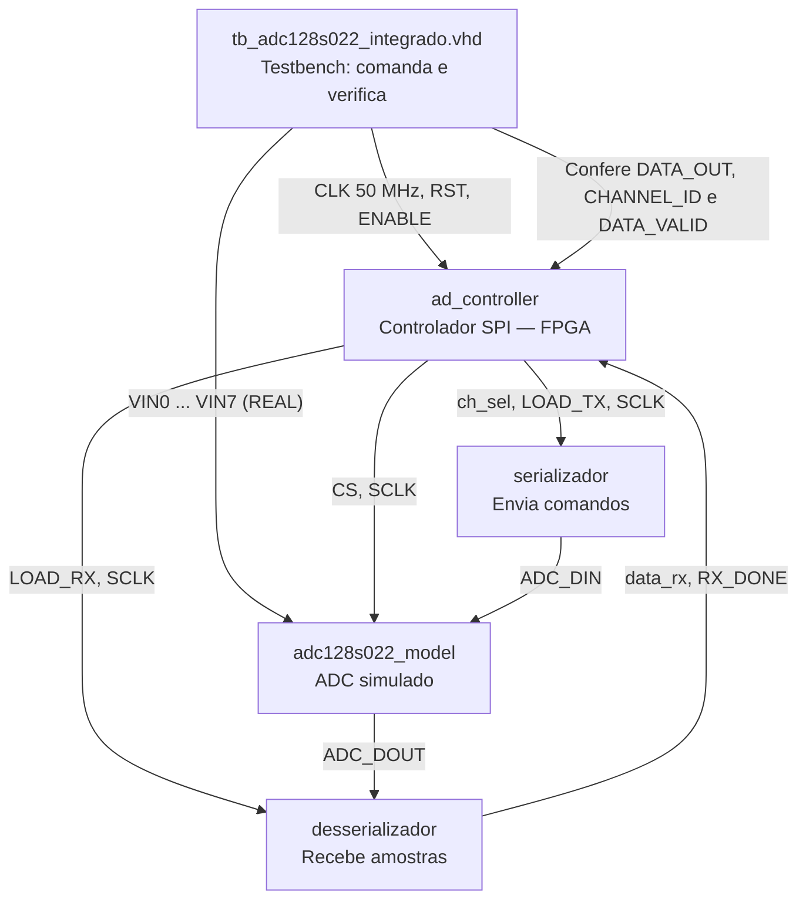

# Guia para iniciantes — como ler e executar o projeto

[← README](../README.md) · [Arquitetura →](arquitetura.md) · [Validação →](validacao.md)

Este guia explica **o que é cada arquivo**, **como eles se conectam** e **quais nomes aparecem no VHDL e no ModelSim**. Você não precisa conhecer todos os detalhes do protocolo SPI para começar: a ideia é seguir o caminho percorrido por uma amostra, da entrada do ADC simulado até `DATA_OUT`.

## 1. Duas partes diferentes: circuito e ambiente de testes

O repositório contém dois grupos de código VHDL:

- **Circuito (`rtl/`):** descreve a lógica projetada para a FPGA. São o controlador, o serializador e o desserializador. Esses são os arquivos que deverão ser considerados na futura implementação com Quartus.
- **Ambiente de simulação (`sim/`):** cria estímulos, simula o chip ADC e verifica se o circuito se comporta como esperado no ModelSim. **Não deve ser enviado para síntese na FPGA.**

> **`tb` significa _testbench_.** É um prefixo convencional usado em nomes como `tb_adc128s022_integrado.vhd` para indicar um arquivo que **testa** outro módulo. O testbench não é o controlador e não faz parte do hardware a ser implementado.

## 2. O que faz cada arquivo?

| Caminho | O que é | Para que serve | Vai para a FPGA? |
|---|---|---|---|
| [`rtl/adc_controller_sclk.vhd`](../rtl/adc_controller_sclk.vhd) | **Controlador principal** (entidade `ad_controller`) | Gera `ADC_CS` e `ADC_SCLK`, seleciona canais, coordena os módulos seriais e indica quando existe uma amostra válida | **Sim** |
| [`rtl/serializador_sclk.vhd`](../rtl/serializador_sclk.vhd) | **Serializador** (entidade `serializador`) | Transforma a palavra de comando de 16 bits em bits enviados por `ADC_DIN` nas descidas de SCLK | **Sim** |
| [`rtl/desserializador_sclk.vhd`](../rtl/desserializador_sclk.vhd) | **Desserializador** (entidade `desserializador`) | Reúne os bits recebidos de `ADC_DOUT` nas subidas de SCLK, formando uma palavra de 16 bits | **Sim** |
| [`sim/adc128s022_model.vhd`](../sim/adc128s022_model.vhd) | **Modelo comportamental do ADC** (entidade `adc128s022_model`) | Imita o conversor real, recebendo oito tensões simuladas e respondendo às transações SPI | **Não** |
| [`sim/tb_adc128s022_integrado.vhd`](../sim/tb_adc128s022_integrado.vhd) | **Testbench integrado** (entidade `tb_adc128s022_integrado`) | Conecta controlador e ADC simulado, gera clock/reset, estabelece entradas e compara saídas com os resultados esperados | **Não** |
| [`sim/simular_modelsim.do`](../sim/simular_modelsim.do) | **Script do ModelSim** | Compila os arquivos na ordem apropriada, abre a simulação, adiciona sinais à janela Wave e executa o teste | **Não** |
| [`docs/arquitetura.md`](arquitetura.md) | Documentação técnica | Explica blocos, sinais, estados e sincronização de `RX_DONE` | Não se aplica |
| [`docs/protocolo-spi.md`](protocolo-spi.md) | Documentação do protocolo | Explica os 16 ciclos SPI, a palavra de comando e o atraso de um frame na seleção de canal | Não se aplica |
| [`docs/validacao.md`](validacao.md) | Relatório de validação | Registra os dez frames testados, critérios de aprovação e testes pendentes | Não se aplica |
| [`docs/implementacao-fisica.md`](implementacao-fisica.md) | Guia de implantação | Reúne as verificações ainda necessárias no Quartus/TimeQuest e na placa DE0-Nano | Não se aplica |
| [`docs/images/ondas_modelsim.png`](images/ondas_modelsim.png) | Captura de simulação | Mostra visualmente as formas de onda | Não se aplica |
| `README.md` | Página inicial | Explica o objetivo do projeto e aponta para as demais páginas | Não se aplica |
| `.gitignore` | Configuração do Git | Evita versionar alguns arquivos temporários e de saída das ferramentas | Não se aplica |

**Dica:** o nome de um arquivo VHDL e o nome de sua entidade não precisam coincidir. Neste projeto, `adc_controller_sclk.vhd` declara a entidade **`ad_controller`**. É esse nome que aparece na instanciação do testbench.

## 3. Como os arquivos se relacionam?



No ModelSim, o testbench é o **módulo de topo da simulação**. Dentro dele, aparecem duas instâncias principais:

- `DUT`: o **controlador real** que queremos testar, cuja entidade é `ad_controller`;
- `U_ADC`: o **modelo comportamental** que faz o papel do ADC físico.

Por sua vez, o controlador instancia `U_TX` (serializador) e `U_RX` (desserializador). Portanto, o encadeamento é:

`tb_adc128s022_integrado` → `DUT / ad_controller` → `U_TX` e `U_RX`, comunicando-se com `U_ADC / adc128s022_model`.

## 4. Tutorial: o caminho de uma amostra

Considere o primeiro frame do testbench, no qual IN0 deve produzir `0x0123` (291 em decimal):

1. **O testbench inicia tudo:** gera o clock de 50 MHz, libera `RST`, ativa `ENABLE` e fornece tensões simuladas para `VIN0` a `VIN7`.
2. **O controlador prepara a leitura:** passa pelos estados `IDLE` e `PREPARE`, calcula o próximo canal e monta a palavra de comando `ch_sel`.
3. **A transferência começa:** em `START_SPI`, o controlador espera o reconhecimento da limpeza de `RX_DONE` anterior, ativa `CS` e habilita SCLK.
4. **O serializador envia o comando:** a cada descida de SCLK, coloca o bit apropriado em `ADC_DIN` (MSB primeiro).
5. **O ADC simulado responde:** lê os bits do comando e apresenta em `ADC_DOUT` os quatro zeros iniciais seguidos dos 12 bits da conversão selecionada.
6. **O desserializador recebe:** captura um bit em cada subida de SCLK e, após a 16ª captura, atualiza a palavra recebida e ativa `RX_DONE`.
7. **O controlador termina o frame:** sincroniza `RX_DONE` no domínio de 50 MHz, encerra a comunicação, registra `CHANNEL_ID` e pulsa `DATA_VALID`.
8. **O testbench verifica o resultado:** ao detectar `DATA_VALID`, compara `CHANNEL_ID` e `DATA_OUT` com os valores esperados e escreve `Frame 1 OK` apenas se estiverem corretos.

**Atenção ao atraso de canal:** o comando transmitido em um frame escolhe o canal da **próxima** conversão. Por isso, no primeiro frame, o controlador recebe IN0 enquanto solicita IN1. Esse detalhe está explicado em [protocolo-spi.md](protocolo-spi.md).

## 5. Minidicionário das siglas e termos

| Termo / nome | Significado neste projeto |
|---|---|
| **VHDL** | Linguagem de descrição de hardware usada nos módulos e nos testes |
| **RTL** | *Register Transfer Level*: descrição da lógica digital que será sintetizada |
| **`tb_` / testbench** | Arquivo que cria estímulos e faz verificações automáticas; **não** é sintetizável |
| **DUT** | *Device Under Test*: o dispositivo **sob teste**; no código, a instância `DUT` é o controlador |
| **UUT** | *Unit Under Test*: nome alternativo para a unidade sob teste; não é o nome usado no testbench integrado atual |
| **`U_ADC`, `U_TX`, `U_RX`** | **Rótulos de instância**: nomes dados a blocos conectados no VHDL; `U_` é apenas uma convenção de nomenclatura |
| **Entidade (`ENTITY`)** | Define os genéricos e as portas externas de um módulo |
| **Arquitetura (`ARCHITECTURE`)** | Descreve o comportamento interno de uma entidade |
| **`PORT MAP`** | Conecta portas de uma instância a sinais do módulo que a contém |
| **`GENERIC MAP`** | Configura parâmetros de uma instância, como `NUM_CANAIS` e `MT_ADC` |
| **FSM** | *Finite State Machine*: máquina de estados que organiza o controle em `IDLE`, `PREPARE`, `START_SPI`, `TRANSFER` e `FINISH` |
| **SPI** | Interface serial síncrona usada para comunicação com o ADC |
| **SCLK** | Clock serial do ADC, gerado pelo controlador; diferente de `CLK` de 50 MHz |
| **CS** | *Chip Select*: habilita o ADC quando está em zero |
| **DIN / MOSI** | Dados enviados da FPGA **para** o ADC (neste projeto, comando de canal) |
| **DOUT / MISO** | Dados enviados do ADC **para** a FPGA (conversão digital) |
| **`LOAD_TX` / `LOAD_RX`** | Preparam o serializador e o desserializador para um novo frame |
| **`TX_DONE` / `RX_DONE`** | Sinais internos de término; `RX_DONE` é usado para a conclusão da recepção |
| **`DATA_OUT`** | Palavra digital de 16 bits recebida, sendo 12 bits de medida e quatro zeros iniciais |
| **`CHANNEL_ID`** | Identifica de qual canal veio a amostra publicada |
| **`DATA_VALID`** | Pulso que avisa à lógica externa que `DATA_OUT` e `CHANNEL_ID` estão válidos |
| **`REAL`** | Tipo usado para representar tensões no **modelo simulado** do ADC; não é destinado à síntese |
| **`.do`** | Arquivo de comandos Tcl/ModelSim; automatiza a execução da simulação |
| **`ASSERT`** | Verificação automática do testbench; gera erro quando uma condição esperada falha |
| **`REPORT`** | Mensagem textual impressa na janela *Transcript* do ModelSim |

## 6. Primeira execução: por onde começar?

1. Abra o ModelSim 10.5b na **raiz do repositório**.
2. No *Transcript*, execute:

   ```tcl
   do sim/simular_modelsim.do
   ```

3. Confirme que as mensagens aparecem de `Frame 1 OK` a `Frame 10 OK`, **sem `** Error:`**.
4. Na janela Wave, observe primeiro `ADC_CS`, `ADC_SCLK`, `ADC_DIN` e `ADC_DOUT`; depois relacione com `DATA_OUT`, `CHANNEL_ID` e `DATA_VALID`.
5. Para entender o protocolo, leia [protocolo-spi.md](protocolo-spi.md). Para estudar o código dos estados e o sincronismo, leia [arquitetura.md](arquitetura.md).

**Não confunda:** o testbench valida o funcionamento **em simulação**. O próximo passo para a placa é sintetizar somente os módulos adequados de `rtl/` e cumprir as verificações listadas em [implementacao-fisica.md](implementacao-fisica.md).
