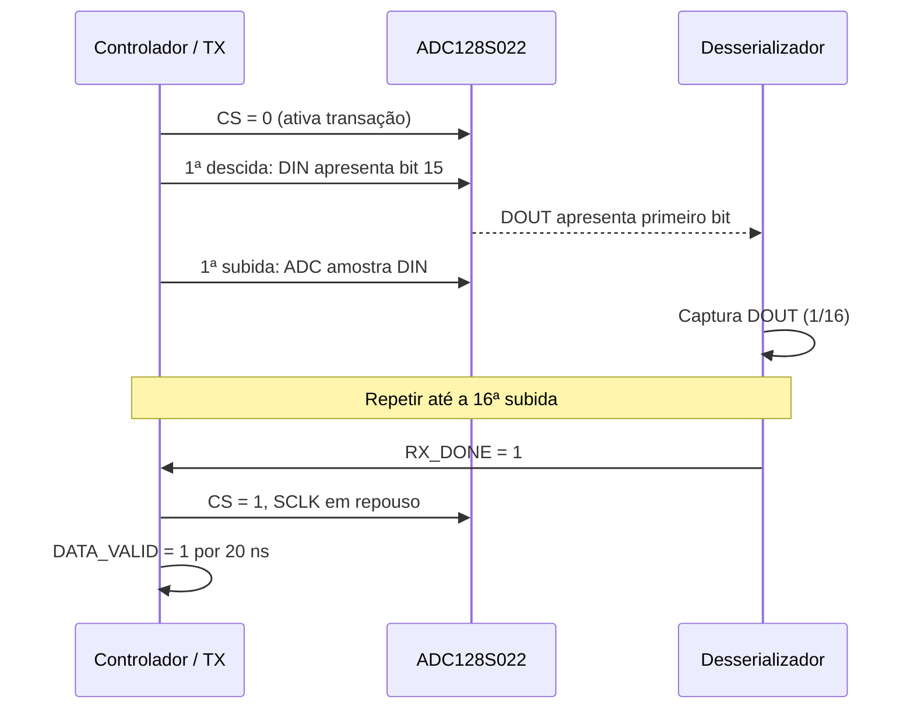

# Protocolo SPI do ADC128S022

[← README](../README.md) · [Guia de arquivos](guia-arquivos.md) · [Arquitetura](arquitetura.md) · [Validação →](validacao.md)

## Estrutura do frame

O ADC128S022 utiliza **16 ciclos de SCLK** por transação. `CS=0` habilita o ADC. Com SCLK inicialmente alto, a sequência considerada neste projeto tem uma descida seguida de uma subida em cada ciclo.

| Ciclo | Bit lido em `DOUT` na subida | Ação de `DIN` |
|---|---|---|
| 1 | Zero de preenchimento | Bit 15 do comando |
| 2 | Zero de preenchimento | Bit 14 do comando |
| 3 | Zero de preenchimento | `ADD2` (bit 13) |
| 4 | Zero de preenchimento | `ADD1` (bit 12) |
| 5 | `DB11` (MSB da amostra) | `ADD0` (bit 11) |
| 6–15 | `DB10` a `DB1` | Bits restantes do comando |
| 16 | `DB0` (LSB da amostra) | Bit 0 do comando |

Assim, `DATA_OUT` corresponde à palavra `0000 DB11 DB10 ... DB0`. O resultado tem **12 bits úteis**; a saída do controlador tem 16 bits por conveniência de interface.

### Seleção de canais

O comando de 16 bits construído pelo controlador tem o formato:

```text
bit:  15 14 | 13 12 11 | 10 .......... 0
      0  0 | ADD2 ADD1 ADD0 | 0 ... 0
```

| Canal solicitado | Comando hexadecimal |
|---|---|
| IN0 | `0x0000` |
| IN1 | `0x0800` |
| IN2 | `0x1000` |
| IN3 | `0x1800` |
| IN4 | `0x2000` |
| IN5 | `0x2800` |
| IN6 | `0x3000` |
| IN7 | `0x3800` |

### Atraso de um frame

O endereço `ADD2:ADD0` enviado durante uma transação **seleciona o canal para a transação seguinte**. Na simulação, a primeira amostra após a inicialização do modelo pertence a IN0.

| Frame | Canal em `DATA_OUT` | Canal solicitado em `DIN` |
|---|---|---|
| 1 | IN0 | IN1 |
| 2 | IN1 | IN2 |
| 3 | IN2 | IN3 |
| ... | ... | ... |
| 8 | IN7 | IN0 |
| 9 | IN0 | IN1 |

O código mantém `ch_atual` e `ch_prox` separados. `CHANNEL_ID` identifica o canal da amostra publicada, **não** o endereço que acabou de ser transmitido.

## Por que clocks em bordas opostas?



- TX desloca **na descida** para preparar MOSI antes da próxima subida.
- RX captura **na subida**, quando DOUT deve estar estável.
- Em `TRANSFER`, `SHIFT_EN` e `SAMPLE_EN` são habilitações de nível; **o evento de amostragem é a borda**, não a permanência de SCLK em nível alto.

## Temporização desta implementação

| Grandeza | Valor |
|---|---|
| Clock FPGA | 50 MHz (20 ns) |
| `MT_ADC` | 16 ciclos de CLK por meio SCLK |
| Meio período de SCLK | 320 ns |
| Período de SCLK | 640 ns |
| Frequência SCLK | 1,5625 MHz |
| 16 ciclos | 10,24 µs |
| Intervalo observado entre `DATA_VALID` sucessivos | ~10,42 µs no teste fornecido |

A margem entre o fim de um frame e o começo do próximo decorre dos estados da FSM e do handshake de `RX_DONE`.

### Observação sobre quantização no testbench

O **modelo comportamental** recebe tensões em `REAL` e gera um código digital ideal saturado em 0–4095. O código usa a conversão VHDL `INTEGER(4096.0 * V_IN / VREF_V)` (arredondamento da expressão real para inteiro), portanto não substitui uma modelagem analógica detalhada do conversor físico.

**Referência primária:** [Datasheet ADC128S022, Texas Instruments](https://www.ti.com/lit/ds/symlink/adc128s022.pdf).
